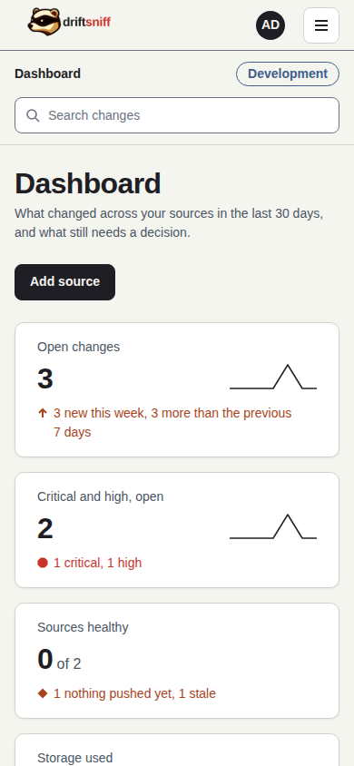
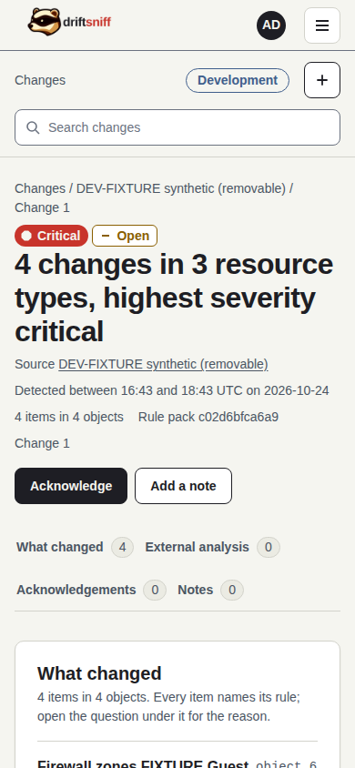

# driftsniff CE

driftsniff Community Edition (CE) is a self-hosted tool that records changes to UniFi Network and
Xen Orchestra configuration, keeps the before and after values, and gives each change an
explainable risk label.

> **Release candidate v27.0.0-rc.2.** This documentation describes the Development candidate
> `51051220f9b932d47bc00fe1aefaf61afd0972e3` (image
> `ghcr.io/theriark/driftsniff-ce@sha256:2bc3627e3b8eda13a62073ee54a6ff6f10d6760b4d7aa697e33606425af5471b`).
> Its application files are identical to build `36f78cc95919b115103af19bd10773d9d69a7386`, on
> which every screenshot was taken; the commits in between changed only documentation, the CI
> workflow and its change classifier. The tag `v27.0.0-rc.2` is created for that exact candidate after this documentation is reviewed; the
> application itself still reports its package version `0.1.0.dev0` in the footer and on the
> settings page. It is not a stable release and not ready for production use.
>
> **No warranty.** The software is provided "as is" under the MIT licence, without warranty of any
> kind. See [LICENSE](LICENSE).


*The dashboard of the Development build, signed in as an admin, light theme, 1440 px wide. Every
name and value on it is synthetic test data.*

## What it does

- Reads the configuration of UniFi Network and Xen Orchestra with read-only access, on a schedule,
  or takes a configuration that a sender pushes to it.
- Stores only what changed, with the before and after values.
- Keeps secret values out of storage: a secret is recorded as a keyed fingerprint only.
- Labels each change low, medium, high or critical, and names the rule that produced the label and
  the reason.
- Never claims to know who made a change: it says when it noticed it.

## The screens

| Screen | What it answers |
|---|---|
| [Dashboard](docs/user-guide.md#the-dashboard) | What changed in the last 30 days, and what still needs a decision |
| [Changes](docs/user-guide.md#the-change-list) | Every change with its severity, source, time and status |
| [Change detail](docs/user-guide.md#a-change) | Each changed field, before and after, with its rule and why it is rated that way |
| [Sources](docs/user-guide.md#sources) | Which systems are watched and how each answered its last check |
| [History and Configuration](docs/user-guide.md#history-and-configuration) | The stored readings of a source and the configuration it holds now |
| [Settings](docs/admin-guide.md) | Users, API tokens, notifications, retention and the build that runs (admins only) |

More desktop screens are in the [user guide](docs/user-guide.md) and the
[tutorials](docs/tutorials/README.md).

## Quick start

You need Docker with the Compose plugin.

```
git clone https://github.com/Theriark/driftsniff-ce.git
cd driftsniff-ce
docker compose up --build -d
docker compose logs driftsniff
```

The log of the first start prints a one-time setup code. Open `http://localhost:8080`, enter the
code, choose the admin user name and a password of at least 12 characters. Then add your first
source. The full steps are in the [installation guide](docs/install.md) and the tutorial
[Sign in for the first time](docs/tutorials/01-first-sign-in.md).

The master key is created on the `keys` volume at the first start. Back it up separately from the
`data` volume: without it the stored credentials and secret fingerprints cannot be read. See
[operations](docs/operations.md).

## Documentation

Start at the [documentation index](docs/README.md). The main guides:

- [Installation](docs/install.md) and [configuration](docs/configuration.md)
- [User guide](docs/user-guide.md) and [admin guide](docs/admin-guide.md)
- [API guide](docs/api-guide.md)
- [Operations: health, backup, restore and upgrade](docs/operations.md)
- [Tutorials](docs/tutorials/README.md), step by step with screenshots
- [Release notes for v27.0.0-rc.2](docs/release-notes/v27.0.0-rc.2.md)

## On a phone

The same pages work on a phone and a tablet. The navigation folds into a menu below 1024 px, and
the stat cards stack into one column.

| Dashboard, 390 px | Navigation menu, 390 px, dark theme | Change detail, 390 px |
|---|---|---|
|  |  |  |

## Develop

See [CONTRIBUTING.md](CONTRIBUTING.md) for the branch flow, the sign-off rule and how to run the
tests. The design and engineering notes of each part are listed under
[reference documents](docs/README.md#reference-documents).

## Security

Report vulnerabilities privately, as described in [SECURITY.md](SECURITY.md).

## Licence

MIT, Copyright (c) 2026 Theriark. The licences of the packages driftsniff uses are listed in
`THIRD_PARTY_NOTICES`, which `scripts/gen_notices.py` generates from the lock files.

## History of this file

Before v27.0.0-rc.1 this README said that driftsniff had no release and nothing to install yet,
and it showed no screens. That was true of the repository until the Phase 10 web interface was
deployed; it no longer is. Earlier review screenshots are kept with their task records, not in this
repository.

The documentation of this candidate was first labelled v27.0.0-rc.1. That label was never tagged
and its review copy is superseded, so the same candidate is documented again as v27.0.0-rc.2.
The [v27.0.0-rc.1 release notes](docs/release-notes/v27.0.0-rc.1.md) are kept as superseded history.
