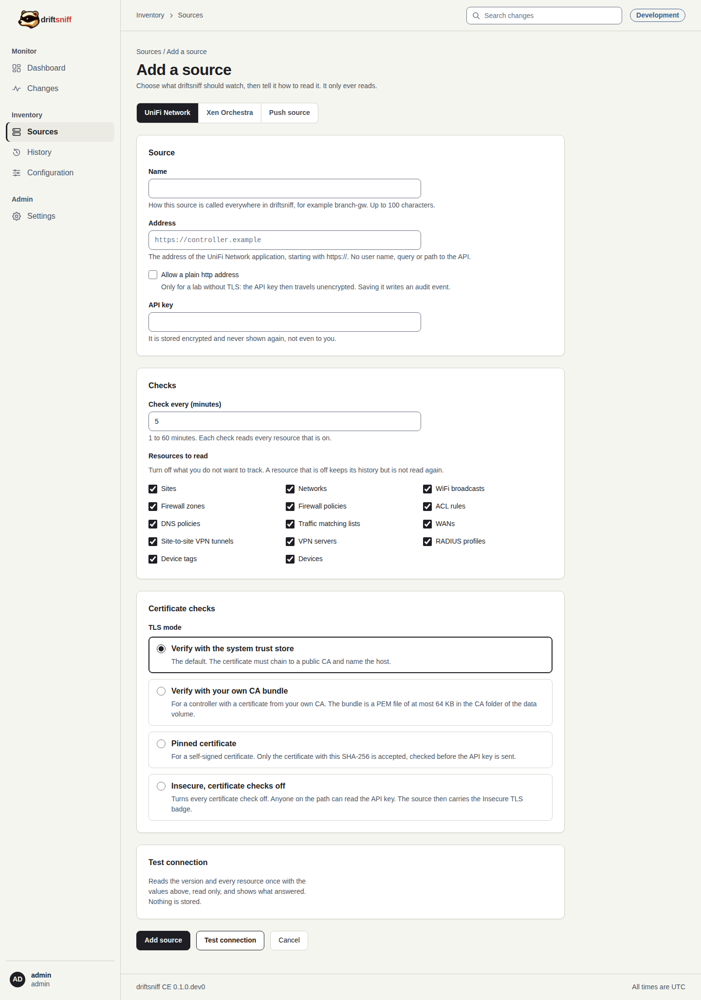
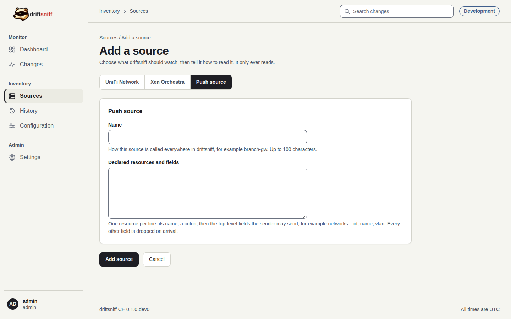

# Admin guide

For release candidate v27.0.0-rc.1, build `36f78cc9`. Everything here needs the admin role. The
screenshots show the Development installation with synthetic data and its three test accounts,
named after their roles.

## Sources

### Add a source

Select **Add source** on the dashboard, the sources list or the header. Choose the kind of source
at the top of the form.

| Kind | What you enter |
|---|---|
| UniFi Network | a name, the `https://` address of the UniFi Network application, a read-only API key, the check interval, the resources to read and the TLS mode |
| Xen Orchestra | a name, the `https://` address of the XO server, an authentication token, optionally the date the token expires (driftsniff warns 14 days before), the interval, the resources and the TLS mode |
| Push source | a name and the declared resources and fields: one resource per line, a colon, then the top-level fields a sender may send, for example `networks: _id, name, vlan`. Every other field is dropped on arrival. |

- **Test connection** reads the version and every resource once, read only, and shows what
  answered. It stores nothing.
- The credential is stored encrypted and never shown again, not even to you. To keep it while you
  edit a source, leave the field empty.
- **Allow a plain http address** is for a lab without TLS only; the credential then travels
  unencrypted, and saving it writes an audit event.
- A resource that you turn off keeps its history but is not read again.
- The TLS modes are explained in [configuration.md](configuration.md#certificate-checks-of-a-source).

Prepare the account on the controller first: [UniFi](guides/unifi-setup.md),
[Xen Orchestra](guides/xo-setup.md). The step-by-step version is the tutorial
[Add a source](tutorials/03-add-a-source.md).

### A push source's sender key

A push source has no address. On its page, **Make sender key** creates the key that the sender
puts in the `X-Driftsniff-Push-Key` header. The key is shown once, in that answer; afterwards the
page only says that a key exists. Making a new key stops the old one at once. See the
[API guide](api-guide.md#push-a-configuration).

### Edit, disable and delete

On the source page: **Edit** (the kind cannot change), **Disable** or **Enable** (the scheduler is
told at once), and **Delete this source**, which removes the source with its snapshots, change
events and coverage after you type its name.

## Settings

**Settings** in the Admin group of the sidebar. The tabs at the top jump to the five cards.

### Users

- The table lists each user with role, state and when it was added. **Disable** ends the user's
  sessions at once and stops their API tokens; **Enable** gives access back. You cannot disable
  yourself, and the last enabled admin cannot be disabled.
- **Add a user:** a user name (3 to 64 characters), a password of at least 12 characters and a
  role. driftsniff sends no mail, so give the password to the person yourself.
- A role cannot be changed and a password cannot be reset in this version. A user locked by wrong
  passwords is unlocked by itself after 15 minutes.

### API tokens

- A token lets a script use `/api/v1`. **Read** lists changes; **Enrich** attaches notes and links
  to a change. A token has no other power and cannot sign in to the interface.
- **Make a token:** a name (who uses it), the scopes and an optional expiry of 1 to 3650 days. The
  value is shown **once**, in a card at the top of the page. Afterwards the list shows only its
  first 8 characters.
- **Revoke** stops a token for good. A token cannot be edited: revoke it and make a new one.

The step-by-step version is the tutorial [Add a user and make an API
token](tutorials/04-add-a-user.md).

### Notifications

One channel gets a message for each change at or above the severity you choose:

- **Webhook:** a signed JSON post to your chat bridge or ticket system. The address is stored
  encrypted and the page shows only its host. **Show signing key** reveals the key that signs each
  post.
- **Email over SMTP:** a plain mail to up to ten addresses through your mail server.
- **Send messages** off keeps the channel but sends nothing. **Send a test message** checks it;
  **Remove channel** deletes it.

Without a channel no alert leaves driftsniff. The message format is in
[notifications.md](notifications.md).

### Retention and storage

- **Retention:** changes older than the window are removed each night at 03:30 UTC. A whole number
  of days from 30 to 365; the default is 365. The card shows the result of the last clean-up.
- **Storage warning:** the dashboard's storage card turns to a warning from this size, 1 to 1000
  GB; the default is 2.

### About

The version, the build commit, the database schema, the database size, the number of sources and
users and the last clean-up. Quote the version and the build when you report a problem.

## Audit

Every admin action (a source added, edited or deleted, a user added or disabled, a token made or
revoked, a setting changed, a sender key made) writes an audit event with your user name and never
a secret. The newest ones appear in the dashboard's Activity timeline.
