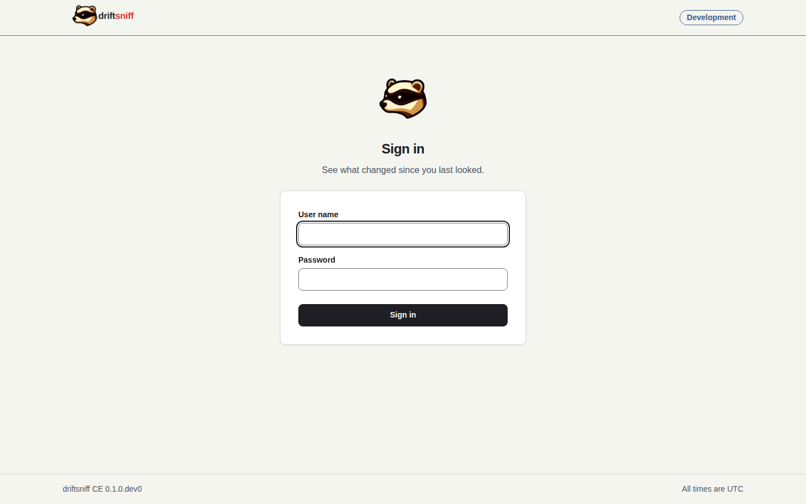

# 1. Sign in for the first time

You start driftsniff, create the first admin and reach the dashboard.

**You need:** a running installation ([installation guide](../install.md), step 1) and access to
its log.

## Step 1: Read the setup code

```
docker compose logs driftsniff
```

At the first start, while no admin exists, the log holds a one-time setup code. It is printed once.
If you lost it, print a new one with
`docker compose exec driftsniff python -m driftsniff create-admin-code`.

## Step 2: Create the admin

Open the address of driftsniff in your browser. With no admin yet, it opens the setup page. Enter:

1. the setup code,
2. the admin user name, 3 to 64 characters (letters, digits and `. _ @ + -`),
3. a password of at least 12 characters.

Submit. You are signed in and the code no longer works. From now on the setup page answers "Page
not found".

The setup page is not shown here: the Development installation already has its admins, so the page
cannot be opened there any more.

## Step 3: Sign in later

Next time, the address opens the sign-in page. Enter the user name and the password and select
**Sign in**.



After five wrong passwords in a minute the page asks you to wait before the next try.

## Step 4: Look at the dashboard

You land on the dashboard. With no source yet it shows one action, **Add source**. Once sources
report, it looks like this:


Read it top to bottom: the stat cards, the open items by severity, and **Needs attention**, the
changes and sources that wait for a decision. The [user guide](../user-guide.md#the-dashboard)
explains every part.

## Step 5: Sign out

Open the user menu with your name at the bottom of the sidebar and choose **Sign out**. The sign-in
page confirms it:


**Next:** [Add a source](03-add-a-source.md).
