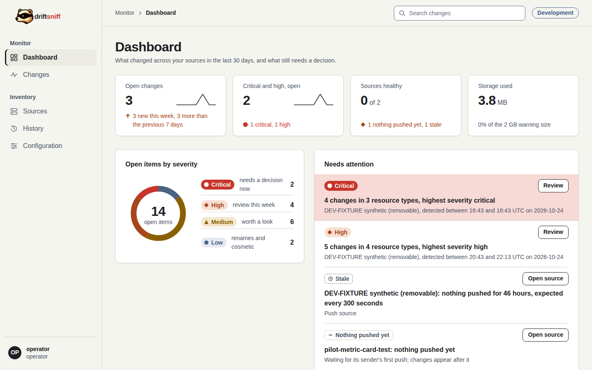

# 2. Review a change and acknowledge it

You open the most urgent change, read what changed and why it is rated that way, and record your
decision.

**You need:** the operator or admin role to acknowledge. A viewer can follow steps 1 to 3.

## Step 1: Find the change

On the dashboard, the **Needs attention** list starts with the open critical and high changes.
Select **Review** on the first row.

You can also open **Changes** in the sidebar and filter by severity or source:

## Step 2: Read what changed

The change page lists each changed item, grouped by object.

For each item read:

1. the severity badge and what happened, for example "Client isolation changed",
2. the rule that rated it, for example `unifi.wifi.client_isolation_off`,
3. **Before** and **After**, with the part that differs boxed.

A secret, such as the pre-shared key of a VPN, shows "secret changed" with two fingerprints. The
value is never stored. Equal fingerprints mean the same value.

The head says when the change was detected, between two check times. It does not say who made it;
find that in the controller's own log.

## Step 3: Read the reason

Open **Why is this rated critical?** (or high, medium, low) under an item. It shows the rule's
reason. If a field changes all the time and does not matter to you, **Mute this path** hides it
from the change list. A critical item cannot be muted.

## Step 4: Acknowledge

As an operator or admin, write what you decided in **Comment (optional)** on the right, for example
"Planned change, ticket NET-123", and select **Acknowledge change**.

The page comes back with a notice, the change is marked acknowledged, and your name, the time and
the comment are listed under Acknowledgements. Acknowledging never changes the severity, and a
second acknowledgement is kept beside the first.

The screenshots show the form before it is submitted: the Development data is shared, so it was
not acknowledged for this tutorial.

## Step 5: Add a note, if needed

Write in **Add a note** and select **Save note** for what you found or what to do next. A note
cannot be edited later.

A viewer sees the same page without the forms:

**Next:** [Read the history and the configuration of a source](05-history-and-configuration.md).
