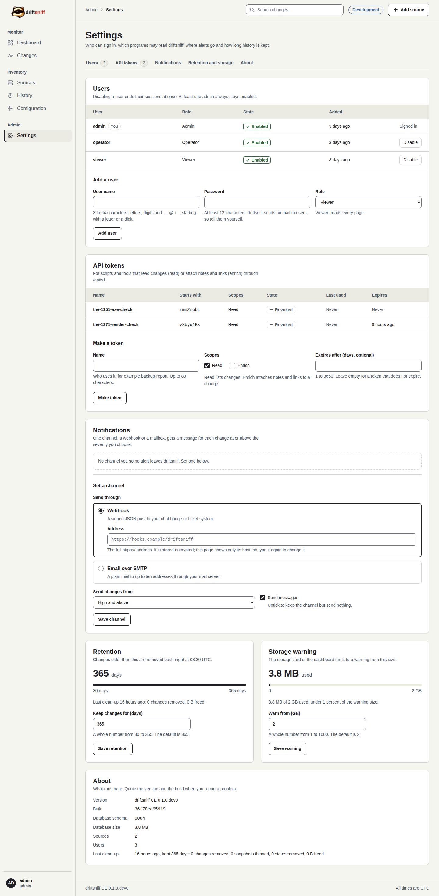

# 4. Add a user and make an API token

You give a colleague their own sign-in and give a script a token that can only read.

**You need:** the admin role.

## Step 1: Open Settings

Select **Settings** in the Admin group of the sidebar. The tabs at the top jump to Users, API
tokens, Notifications, Retention and storage, and About.

## Step 2: Add the user

In **Users**, under **Add a user**:

1. **User name**, 3 to 64 characters, for example `alex.ops`.
2. **Password**, at least 12 characters.
3. **Role**: Viewer reads every page; Operator also acknowledges, writes notes, mutes paths and
   runs a source now; Admin manages everything.

Select **Add user**. The user appears in the table. driftsniff sends no mail, so give the password
to the person yourself.

To take access away, select **Disable** on the user's row. Their sessions end at once and their
API tokens stop working. You cannot disable yourself or the last enabled admin.

## Step 3: Make a token

In **API tokens**, under **Make a token**:

1. **Name**, who uses it, for example `backup-report`.
2. **Scopes**: keep **Read** for a script that lists changes; add **Enrich** only for a program
   that attaches notes to changes.
3. **Expires after (days, optional)**, for example `90`. Empty means it does not expire.

Select **Make token**. The value appears once, in a card at the top of the page. Copy it into the
script's secret store now; the list afterwards shows only its first 8 characters.

## Step 4: Use and revoke

The script sends the token in the `Authorization` header with the word `Bearer`; see the
[API guide](../api-guide.md). When the script is retired or the token may have leaked, select
**Revoke** on its row. A revoked token stops at once, for good.

The screenshot shows the forms before they are submitted: no user or token was made on
Development for this tutorial. The two revoked tokens in the list are test tokens of earlier
checks.

**Next:** [Read the history and the configuration of a source](05-history-and-configuration.md).
